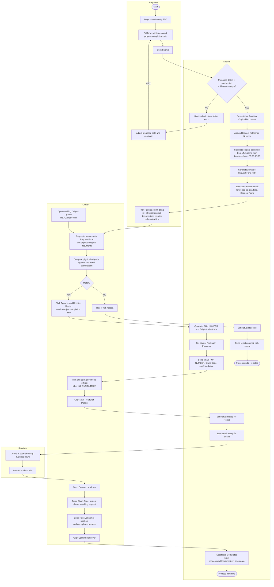

# Software Requirements Specification (SRS)

## Online Document Printing Request System (ODPRS)
### Registrar Division, Mae Fah Luang University

| | |
|---|---|
| **Document Version** | 0.4 (Draft) |
| **Date** | 06/08/2026 |
| **Submitted by** | Sorrawit Thanakhwang (6531503080) |

---

## Table of Contents
- [Revision History](#revision-history)
- [Document Approval](#document-approval)
1. [Introduction](#1-introduction)
   - 1.1 [Business Background](#11-business-background)
   - 1.2 [Business Objective](#12-business-objective)
   - 1.3 [Business Scope](#13-business-scope)
   - 1.4 [Business Workflow](#14-business-workflow)
   - 1.5 [Definitions, Acronyms and Abbreviations](#15-definitions-acronyms-and-abbreviations)
2. [Overall Description](#2-overall-description)
   - 2.1 [Product Perspective](#21-product-perspective)
   - 2.2 [User Classes and Characteristics](#22-user-classes-and-characteristics)
3. [Software Requirement](#3-software-requirement)
   - 3.1 [Business Requirements](#31-business-requirements)
   - 3.2 [Overall Product Function](#32-overall-product-function)
   - 3.3 [Functional Requirements](#33-functional-requirements)
   - 3.4 [Software Quality Attributes (Non-functional Requirements)](#34-software-quality-attributes-non-functional-requirements)
   - 3.5 [External Interface Requirements](#35-external-interface-requirements)
   - 3.6 [User Interfaces](#36-user-interfaces)
- [Appendix A: Data Dictionary](#appendix-a-data-dictionary)
- [Appendix B: Open Items / Assumptions](#appendix-b-open-items--assumptions)
- [Appendix C: Development Roadmap](#appendix-c-development-roadmap)

---

## Revision History

| No. | Name | Date | Description | Version |
|---|---|---|---|---|
| 1 | Sorrawit Thanakhwang | 17/07/2026 | Initial Document (template + Business Background/Objective/Scope) | 0.1 |
| 2 | Sorrawit Thanakhwang | 22/07/2026 | Added Business Workflow, User Classes, Functional/Non-functional Requirements, Data Dictionary | 0.2 |
| 3 | Sorrawit Thanakhwang | 29/07/2026 | Major rework based on confirmed stakeholder requirements: ODPRS is now a standalone, semi-online system — Requesters no longer attach files; physical original documents must be hand-delivered to the Officer. Added Admin role and Officer account management. Redefined business rules (no minimum copies; two independent lead-time rules). Introduced Request Reference Number (assigned at submission) as distinct from RUN NUMBER (assigned only after physical verification), plus new "Ready for Pickup" status. Updated workflow, functional requirements, non-functional requirements, and data dictionary accordingly | 0.3 |
| 4 | Sorrawit Thanakhwang | 06/08/2026 | Major rework based on a follow-up round of stakeholder requirements gathering: restructured the print request form (finishing and binding are now independent multi-select choices; print settings split into Color Mode and Print Side to support paper-sheet calculation; added Document Type with a resulting Paper Source responsibility rule; added an optional per-copy running number "Copy Label"). Formalized the previously undocumented resource-usage analytics Dashboard as a real functional requirement (FR-16). Replaced physical-ID-based Receiver verification at Counter Handover with recording the Receiver's name, position, and work phone number — an accountability record, not an identity check. Removed the Folding option (no longer offered). | 0.4 |

## Document Approval

The following Software Requirements Specification has been accepted and approved by the following:

| Name | Role | Signature | Date |
|---|---|---|---|
| | Advisor | | |
| | Reviewer | | |
| | Reviewer | | |

---

## 1. Introduction

### 1.1 Business Background

To improve convenience and operational efficiency, the university plans to introduce an Online Document Printing Request System as a standalone web application, independent of existing university systems (aside from authentication). Currently, the process relies solely on physical forms, which can lead to processing delays and tracking difficulties. ODPRS digitizes the *request, validation, tracking, and handoff-verification* steps.

Because the documents being printed are frequently official/internal university documents, the physical source material itself must never be uploaded, stored, or transmitted electronically. ODPRS is therefore a **semi-online** system: the request (what to print, specifications, and desired date) is submitted online, but the Requester must still hand-carry the physical original documents to the Officer in person before printing can begin. This design eliminates the risk of confidential documents leaking through file upload/storage while still digitizing everything else (validation, tracking, notification, and handoff verification).

### 1.2 Business Objective

To introduce a secure, standalone, web-based platform that lets Requesters submit print requests online while keeping physical original documents entirely outside the system, and lets Officers review request history, monitor live status, and see an overall picture of all requests — including how much paper/print resource is being consumed — at any time.

Three design principles guide every requirement in this document:

1. **Semi-Online, Physical Original Required** — ODPRS never accepts a file attachment or scanned copy of the document to be printed. A request only describes *what* to print (specs, item list, page/copy counts) and a desired date; the Requester must physically bring the original document to the counter before the Officer can act on the request. This protects official/confidential documents from ever existing in digital form within the system.
2. **Lean & Realistic UX** — The system must be usable with the equipment already at the counter. No new hardware purchases are required (e.g., no barcode scanners, no signature tablets); Officers operate the system entirely from the desktop computer already at their station.
3. **Full Visibility & Auditability** — Officers must be able to check the live status of every request, see which requests are still pending/overdue, retrieve a permanent historical/audit record of every completed handoff, and see resource-usage trends (paper consumption by agency, category, and time period) to support planning.

### 1.3 Business Scope

**Software Product**
"Online Document Printing Request System" (ODPRS)

**Capabilities & System Boundaries**

**In-Scope:**
- Standalone web portal for submitting print specifications online (paper size, color mode, single/double-sided printing, finishing method, item list, original page count, number of copies, document type, and a proposed completion date) — **no file or document attachment of any kind**.
- Login restricted to university email accounts, authenticated via the university's SSO; role (Requester/Officer) is assigned inside ODPRS itself, managed by an Admin.
- Automated, real-time enforcement of business rules before a request can be submitted (minimum lead time for the proposed completion date).
- System-calculated deadline (based on business hours) by which the Requester must physically deliver the original documents to the Officer.
- Automatic determination and clear display of who must supply the physical printing paper (the Requester or the Registrar Division) based on Document Type, along with the exact number of paper sheets required.
- An optional, Requester-configured per-copy running number ("Copy Label") printed on each physical copy, independent of the system's own tracking numbers.
- System-generated, printable Request Form (PDF) that the Requester brings to the counter together with the physical original documents.
- Officer dashboard for reviewing requests awaiting physical document drop-off (including an overdue view), comparing the physical originals against the submitted specification, approving/rejecting, and marking jobs ready for pickup.
- RUN NUMBER assignment and 6-digit Claim Code generation, issued only after the Officer physically receives and verifies the original documents.
- Verification module at the counter (Officer inputs the Claim Code and records the Receiver's name, position, and work phone number via the existing desktop PC).
- Officer-facing resource-usage analytics Dashboard, breaking down print/paper volume by year, month, agency category, and agency unit.
- Automated email notifications to the Requester for every status change.
- Permanent audit/history log binding Requester, Officer, Receiver, and timestamp to every completed RUN NUMBER, searchable by Officers.

**Out-of-Scope:**
- Any file/document upload or attachment (explicitly disallowed for confidentiality reasons) — the physical original must always be hand-delivered.
- Physical campus delivery (collection remains in-person at the counter).
- Direct printing hardware integration (Officers manually send files/print jobs using existing office equipment).
- Online payment gateways (expenses billed directly to internal university department accounting).
- Barcode scanner / signature tablet hardware (verification is done via Claim Code entry plus recording the Receiver's name, position, and work phone number on the existing PC — no physical ID inspection is performed).
- A Receiver-facing login/portal — the Receiver never logs into ODPRS.
- Automatic cancellation/expiry of requests whose physical-document deadline has passed — these remain open and must be handled manually by an Officer (see [FR-08](#33-functional-requirements)).

### 1.4 Business Workflow

The workflow below reflects five actors — **Requester**, **System (ODPRS)**, **Officer**, **Receiver**, and **Admin** (account/role management, shown separately as it runs outside the per-request flow) — and mirrors the paper form's fields while digitizing validation, tracking, and handoff, without ever digitizing the source document itself.



**Narrative summary:**

1. The Requester logs in via the university SSO using a university email account, fills in the print request form (print specifications only — **no file attachment**), and proposes a completion/pickup date.
2. The System validates in real time that the proposed date is at least 3 business days from today; the Requester cannot click Submit until this passes.
3. On successful submission, the System assigns a **Request Reference Number**, calculates the **original-document drop-off deadline** from the submission timestamp and business hours (09:00–15:00): if submitted during business hours on a business day, the deadline is the same day by 15:00; otherwise, it is the next business day, 09:00–15:00. The System generates a printable **Request Form (PDF)** and emails the Requester with the reference number, deadline, and the form. Status becomes `Awaiting Original Document`.
4. The Requester prints the Request Form and hand-delivers it together with the physical original documents to the Officer, before the calculated deadline.
5. The Officer compares the physical original documents against the specification submitted in the system (item list, original page count, etc.).
   - If they **do not match**, the Officer rejects the request with a reason; status becomes `Rejected` and the Requester is emailed the reason. Process ends.
   - If they **match**, the Officer clicks **Approve and Receive Master**, confirming or adjusting the completion date. The System generates the **RUN NUMBER** and a random **6-digit Claim Code**, and emails both plus the confirmed date to the Requester. Status becomes `Printing In Progress`.
6. The Officer prints and packs the documents offline (manually, using existing office equipment) and labels them with the RUN NUMBER.
7. Once printing is physically done, the Officer clicks **Mark Ready for Pickup**; status becomes `Ready for Pickup` and the System emails the Requester that the documents are ready for collection during business hours.
8. On or after the confirmed date, the Receiver (the Requester or a designated third party, e.g. a TA) arrives at the counter with the Claim Code.
9. The Officer opens **Counter Handover**, enters the Claim Code to pull up the matching request, and records the Receiver's name, position, and work phone number.
10. On **Confirm Handover**, the System sets status to `Completed`, permanently binding Requester, Officer, Receiver, and timestamp to the RUN NUMBER as an auditable record.

If the Requester never delivers the physical original documents by the calculated deadline, the request is **not** automatically cancelled — it remains `Awaiting Original Document` indefinitely. The Officer's dashboard must visually distinguish/filter these overdue requests so staff can notice and follow up manually (see [FR-08](#33-functional-requirements)).

**Real-world (paper) process vs. digital (ODPRS) process:**

| Step | Paper-based Process (current) | ODPRS Digital Process |
|---|---|---|
| Request submission | Requester fills a physical form by hand and submits at the counter or via internal mail | Requester logs in via university SSO and submits an online form describing the print job (no file attached) |
| Business rule check | Officer manually checks lead time | System automatically validates the proposed completion date (≥3 business days) before allowing submission |
| Source document handling | Physical document handed over with the paper form | Physical document is still hand-delivered — never uploaded or stored digitally, only referenced by specification |
| Paper supply | Decided ad hoc, case by case | System automatically determines and displays whether the Requester or the Registrar Division supplies the paper, and exactly how many sheets, based on Document Type |
| Tracking number | Manually written "RUN NUMBER" on the form | System assigns a Request Reference Number at submission, then a RUN NUMBER once the physical original is received and approved |
| Status tracking | No visibility; Requester must call or visit in person | Requester can track status online in real time (Awaiting Original Document / Rejected / Printing In Progress / Ready for Pickup / Completed) |
| Approval | Officer reviews physical documents and signs | Officer compares hand-delivered originals to the on-screen specification and clicks Approve & Receive Master / Reject |
| Notification | None, or informal (phone call) | Automated email to the Requester at every status change |
| Handoff verification | Physical signature of Requester, Officer, and Receiver on the form | Officer enters Claim Code + records Receiver name, position, and work phone number on the existing PC; system logs the handover digitally |
| Resource visibility | No aggregate view; paper usage is not tracked | Officer-facing Dashboard shows paper/print volume by year, month, agency category, and agency unit |
| Hardware required | Paper, pen, filing cabinet | Existing desktop PC only (no scanner/tablet) |

### 1.5 Definitions, Acronyms and Abbreviations

This section defines terms, roles, and abbreviations used throughout this SRS to properly interpret the requirements of the Online Document Printing Request System (ODPRS).

**Terms**

| Term | Description |
|---|---|
| Requester | A university faculty or staff member (or another non-student university role) who logs into ODPRS using a university email account to submit a print request and track its status. **Students are explicitly excluded from the Requester role**, consistent with the original paper-based process. The Requester never attaches or uploads the document to be printed — see [Semi-Online, Physical Original Required](#12-business-objective). Equivalent to the generic "User" role in a standard SRS. |
| Officer | Registrar Division staff who log into ODPRS to review requests awaiting physical document drop-off, approve or reject them after comparing the physical originals to the submitted specification, print/pack documents, mark jobs ready for pickup, and record the Receiver's information at the counter before handover. |
| Receiver | The individual who physically arrives at the Registrar Division counter to collect the printed documents. The Receiver does not log into the system; they present a Claim Code and provide their name, position, and work phone number to the Officer for the handover record — this is an accountability record of who collected the documents, not an identity check (see Claim Code). The Receiver may be the same person as the Requester or a third party designated by them (e.g. a TA). |
| Admin | A role within ODPRS responsible for managing which university email accounts have the Officer role. Not a per-request actor; operates outside the request workflow. |
| Stakeholder | Any person who has an interest in ODPRS but does not directly develop it — e.g., the Registrar Division head who approves this SRS, or university IT who maintains SSO integration. |
| Registrar Division | The university department that owns the document printing service and operates ODPRS. |
| Print Request | A single submission made by a Requester containing print specifications (paper size, color mode, print side, finishing method, item list, original pages, number of copies, Document Type) and a proposed completion date — with **no** attached file. |
| Document Type | A single classification, chosen once per request (Exam or General Document), that determines paper-supply responsibility (see Paper Source). A request cannot mix both types — a Requester needing to print both an exam and a general document must submit two separate requests. |
| Paper Source | Determines who supplies the physical paper for a print job. For a **General Document**, the Requester must always supply the paper themselves — office paper stock may not be used, and no choice is offered on the form. For an **Exam**, the Requester chooses between the Registrar Division's own paper stock or bringing their own. |
| Request Reference Number | The identifier the system assigns immediately upon successful submission, before any physical document has been received. Printed on the Request Form and used by the Officer to look up the request when the Requester arrives. |
| Request Form | The system-generated, printable (PDF) document containing all submitted request data, which the Requester prints and brings to the counter together with the physical original documents. |
| RUN NUMBER | The unique, sequential tracking number the system assigns only after the Officer has physically received the original documents and clicked Approve and Receive Master. Used for printing/labeling and long-term tracking. |
| Claim Code | A random 6-digit code generated together with the RUN NUMBER at Approve and Receive Master. Presented at the counter so the Officer can look up the matching request and confirm handover, without needing a barcode scanner. The Officer records the Receiver's name, position, and work phone number alongside it — this establishes who collected the documents for accountability purposes, but is **not** an identity-verification step; no physical ID is inspected. |
| Copy Label | An optional, per-copy running number (e.g. `M-10` through `M-100`) that the Requester may request to be printed in the top-right corner of each physical copy's first page, purely for the Requester's own tracking purposes (e.g. numbering exam papers by seat). Configured on the request form as a prefix plus a starting number; the ending number is always derived from Number_of_Copies and previewed before submission. **Entirely independent of, and not to be confused with, the system's own Request Reference Number or RUN NUMBER** — Copy Label is per-physical-copy, chosen freely by the Requester, and has no bearing on internal tracking. |
| Total Pages to Print | A derived value (Original_Pages × Number_of_Copies), not a stored field — the total logical content pages a print job represents. Shown wherever staff need to gauge a job's content size at a glance: the Request Form, the RUN NUMBER form, the Officer's request detail screen, and the Printing Jobs queue (where it's shown as a total plus its page × copies breakdown). Distinct from Total Sheets to Print, which counts physical paper. |
| Total Sheets to Print | A derived value, not a stored field, representing the actual physical paper sheets a print job requires — this is the number relevant to whoever must supply the paper. Computed as `⌈Original_Pages ÷ 2⌉ × Number_of_Copies` when Print_Side is Double-sided (two content pages fit on one physical sheet), or `Original_Pages × Number_of_Copies` when Print_Side is Single-sided. Shown alongside Total Pages to Print on the Request Form and Officer views, together with the Paper Source responsibility notice. |
| Original Document Drop-off Deadline | The date/time, calculated from the submission timestamp and business hours (09:00–15:00), by which the Requester must hand-deliver the physical original documents to the Officer. |
| Business Day | Monday through Friday. Saturday and Sunday are excluded from every day-count in this document (the ≥3-business-day lead time, the drop-off deadline) because they are government non-working days. Thai public holidays that fall on a weekday are a known gap — not yet tracked by the system (see Appendix B). |
| Business Hours | 09:00–15:00 on business days, used both for computing the drop-off deadline and for counter operations such as handover. |
| Overdue | A request still in status `Awaiting Original Document` whose drop-off deadline has passed. Not auto-cancelled; the Officer dashboard must surface it so staff can follow up. |
| Business Rules | The conditions enforced automatically before a request can be submitted: the proposed completion date must be at least 3 business days after the submission date. There is no minimum or maximum on the number of copies. |
| Lean & Realistic UX | The design principle that all Officer-facing workflows (queue review, approval, counter verification) must run on the desktop computer already at the counter, with no new hardware purchase. See [Business Objective](#12-business-objective). |
| Semi-Online | The design principle that ODPRS digitizes the request/validation/tracking/handoff-verification steps, but never accepts a digital copy of the document to be printed — the physical original is always hand-delivered. See [Business Objective](#12-business-objective). |

**Acronyms and Abbreviations**

| Acronym | Description |
|---|---|
| ODPRS | Online Document Printing Request System — the software product described in this SRS |
| MFU | Mae Fah Luang University |
| SRS | Software Requirements Specification |
| SSO | Single Sign-On — the university authentication mechanism used for login |
| BR | Business Requirement |
| FR | Functional Requirement |
| NFR | Non-Functional Requirement |
| DB | Database |
| PK / FK | Primary Key / Foreign Key (used in the Data Dictionary, Appendix A) |

---

## 2. Overall Description

### 2.1 Product Perspective

ODPRS is a **standalone** web-based system, independent of other university systems, apart from two integration points:
- The university's **SSO** for authentication.
- The university **email system** for automated notifications.

ODPRS deliberately never stores, transmits, or displays a digital copy of the document to be printed — no file upload capability exists anywhere in the system. This is a security-by-design choice: because official/internal university documents are frequently involved, removing the file-upload surface removes an entire class of data-leak risk. All source-document handling remains physical, verified in person by the Officer.

The system also does not integrate with printing hardware or require any new peripheral devices — all Officer-side actions (queue review, approve/reject, ready-for-pickup, claim code verification) are performed through a standard web browser on the desktop computer already available at the counter.

### 2.2 User Classes and Characteristics

| User Class | Description |
|---|---|
| Requester | University members who need documents printed. Logs in with a university email account. Uses the system infrequently (per request), submits print specifications and a proposed date, and tracks status online. Never uploads a file. Low-to-medium technical expertise assumed. |
| Officer | Registrar Division staff responsible for reviewing requests, physically comparing hand-delivered originals to submitted specs, approving/rejecting, assigning RUN NUMBERs, marking jobs ready for pickup, recording Receiver information at the counter, and reviewing resource-usage trends on the Dashboard. Uses the system daily; primary power user. |
| Receiver | The individual who arrives at the counter to collect the printed documents. May be the Requester or a designated third party. Does not log in to the system directly — only presents a Claim Code and provides name/position/work phone to the Officer. |
| Admin | Manages which university email accounts are granted the Officer role within ODPRS. Uses the system rarely (only when Officer staffing changes). |

---

## 3. Software Requirement

### 3.1 Business Requirements

| BR # | Description |
|---|---|
| BR-01 | Digitize the request, validation, tracking, and handoff-verification steps of the existing paper-based process, while requiring the physical original document to always be hand-delivered — never uploaded — to protect confidential/official documents. |
| BR-02 | Automatically enforce a minimum 3-business-day lead time between submission and the proposed completion date, and require that date itself to be a business day (not a Saturday/Sunday), before a request can be submitted; the number of copies is unlimited (no minimum, no maximum). |
| BR-03 | Automatically calculate and communicate a deadline, based on business hours, by which the Requester must physically deliver the original documents to the Officer. |
| BR-04 | Provide real-time, self-service status tracking for Requesters, reducing phone/in-person inquiries to the Registrar Division. |
| BR-05 | Provide an auditable digital record of the full request lifecycle (submission → physical verification → approval/rejection → printing → handoff), binding Requester, Officer, Receiver, and timestamp. |
| BR-06 | Enable physical document handoff to be logged with a Claim Code plus the Receiver's name, position, and work phone number — an accountability record, not an identity-verification step — using only equipment already available at the counter. |
| BR-07 | Restrict system access to university email accounts (address must end in `@mfu.ac.th`) authenticated via the university SSO, with Officer and Admin roles explicitly assigned inside ODPRS rather than inferred from SSO alone. |
| BR-08 | Give Officers visibility into requests whose physical-document deadline has passed, without automatically cancelling them. |
| BR-09 | Automatically determine, based on Document Type (Exam vs. General Document), who is responsible for supplying the physical printing paper, and clearly communicate the exact number of paper sheets required to whichever party is responsible. |
| BR-10 | Give Officers a resource-usage analytics view of print volume (requests, copies, pages, and paper sheets) broken down by year, month, agency category, and agency unit, to support institutional planning and budgeting. |

### 3.2 Overall Product Function

| FR # | Function name | User class | Dependency |
|---|---|---|---|
| FR-01 | Login via university SSO | Requester, Officer | None |
| FR-02 | Manage Officer accounts | Admin | FR-01 |
| FR-03 | Fill and submit print request form (no attachment) | Requester | FR-01 |
| FR-04 | Real-time validation of proposed completion date (≥3 business days) | System | FR-03 |
| FR-05 | Assign Request Reference Number and drop-off deadline | System | FR-04 |
| FR-06 | Generate printable Request Form (PDF) | System | FR-05 |
| FR-07 | Send automated status-update email | System | FR-05 |
| FR-08 | View Awaiting Original queue, incl. Overdue filter | Officer | FR-01 |
| FR-09 | Compare physical original documents against submitted specification | Officer | FR-08 |
| FR-10 | Approve and Receive Master (generate RUN NUMBER + Claim Code, confirm date) | Officer, System | FR-09 |
| FR-11 | Reject request with reason | Officer | FR-09 |
| FR-12 | Mark request Ready for Pickup | Officer | FR-10 |
| FR-13 | Track request status | Requester | FR-05 |
| FR-14 | Verify Claim Code and Receiver info; confirm handover | Officer, System | FR-12 |
| FR-15 | View audit/history log of past requests | Officer | FR-14 |
| FR-16 | View resource-usage analytics Dashboard | Officer | FR-01 |
| FR-17 | Compute Total Sheets to Print and paper-supply responsibility | System | FR-03 |
| FR-18 | Configure optional per-copy running number (Copy Label) | Requester, System | FR-03 |

### 3.3 Functional Requirements

**FR-01 — Login via university SSO**
| | |
|---|---|
| Description | The system shall authenticate users via the university's Single Sign-On (SSO), accepting only accounts whose email address ends in `@mfu.ac.th` (faculty/staff), and shall then determine the user's ODPRS role (Requester or Officer) from the internal role-assignment table maintained by Admin. |
| User Class (Actors) | Requester, Officer |
| Priority | High |
| Input | University SSO credentials |
| Output | Authenticated session and redirection to the appropriate landing page (request form for Requester, dashboard for Officer) |
| Workflow | 1. User selects "Login" 2. User is redirected to university SSO 3. On success, the system creates a session 4. System looks up the email in the Officer account table: found → Officer dashboard; not found → Requester request form |

**FR-02 — Manage Officer accounts**
| | |
|---|---|
| Description | The system shall allow an Admin to grant or revoke the Officer role for a given university email address. Any authenticated university email not on this list defaults to the Requester role. |
| User Class (Actors) | Admin |
| Priority | High |
| Input | University email address, grant/revoke action |
| Output | Updated Officer account list |
| Workflow | 1. Admin opens Officer account management 2. Admin adds or removes an email 3. System updates the role-assignment table used by FR-01 |

**FR-03 — Fill and submit print request form**
| | |
|---|---|
| Description | The system shall allow a logged-in Requester to fill in print specifications — paper size, color mode (Black & White / Color), print side (Single-sided / Double-sided), finishing method (Corner Staple / Side Staple / Hole Punch / Saddle-stitch Binding / Coil Binding / Cloth Tape Binding / Glue Binding — any combination may be selected, since the Registrar Division counter finishes jobs by hand rather than with one dedicated machine per technique, except that Corner Staple and Side Staple are mutually exclusive with each other, and the four Binding values — Saddle-stitch, Coil, Cloth Tape, Glue — are mutually exclusive with each other, since each defines the final bound state of the whole document; other combinations remain open pending further confirmation, see Appendix B), item list, number of original pages, number of copies, Document Type (Exam or General Document — exactly one per request), and, only when Document Type is Exam, Paper Source (Office-provided or Requester-provided) — and propose a completion date. No file or document attachment is offered anywhere in the form. |
| User Class (Actors) | Requester |
| Priority | High |
| Input | Requester name, tel (personal or work number), agency, paper size, color mode, print side, finishing method, item list, original pages, number of copies, Document Type, Paper Source (Exam only), proposed completion date |
| Output | Draft request passed to FR-04 for validation |
| Workflow | 1. Requester fills form fields, choosing Document Type first 2. If Document Type is Exam, Requester also chooses Paper Source; if Document Type is General Document, the system fixes Paper Source to Requester-provided and states this on-screen without offering a choice 3. Requester proposes a completion date 4. Requester clicks Submit 5. Request is passed to real-time validation (FR-04) |

**FR-04 — Real-time validation of proposed completion date**
| | |
|---|---|
| Description | The system shall check, before allowing submission, that the proposed completion date (a) is at least 3 business days after the current date, and (b) itself falls on a business day (Monday-Friday — the Registrar counter is closed Saturday/Sunday, so a weekend date could never actually be honored). The Submit action is unavailable/blocked until both conditions are satisfied; there is no minimum or maximum on the number of copies. The form also displays the counter's Business Hours (09:00–15:00) alongside the date field, since that is when the confirmed completion date will actually be honored. |
| User Class (Actors) | System |
| Priority | High |
| Input | Proposed completion date, current date |
| Output | `Valid` → request proceeds to FR-05; `Invalid` → inline error (either "too soon" or "falls on a weekend"), Requester adjusts the date |
| Workflow | 1. System computes business days between today and the proposed date 2. If < 3, show inline error and keep Submit disabled 3. If the date falls on a Saturday/Sunday, show inline error and keep Submit disabled 4. If both checks pass, allow submission to proceed |

**FR-05 — Assign Request Reference Number and drop-off deadline**
| | |
|---|---|
| Description | Upon successful submission, the system shall assign a unique Request Reference Number and compute the original-document drop-off deadline from the submission timestamp and business hours (09:00–15:00): same business day by 15:00 if submitted within business hours on a business day, otherwise the next business day 09:00–15:00. |
| User Class (Actors) | System |
| Priority | High |
| Input | Validated request, submission timestamp |
| Output | Request Reference Number, drop-off deadline, status `Awaiting Original Document` |
| Workflow | 1. System generates the Request Reference Number 2. System computes the drop-off deadline 3. Status is set and both are stored against the request 4. Request Form generation is triggered (FR-06) |

**FR-06 — Generate printable Request Form (PDF)**
| | |
|---|---|
| Description | The system shall generate a printable document (PDF) containing all submitted request data, the Request Reference Number, the computed Total Pages to Print and Total Sheets to Print, the paper-supply responsibility notice, and the Copy Label range (when configured), for the Requester to print and bring to the counter with the physical original documents. Implemented as an on-demand, server-rendered PDF (headless Chromium via Puppeteer) rather than a file persisted at submission time — the PDF is generated fresh on every download request from the same live page a browser's own print would use, so it can never drift out of sync and always reflects current data (e.g. RUN NUMBER/Claim Code once assigned). A "Download PDF" button is available on both the Requester's Request Form page and the Officer's RUN NUMBER form view. |
| User Class (Actors) | System |
| Priority | High |
| Input | Submitted request data, Request Reference Number |
| Output | Downloadable Request Form (PDF) |
| Workflow | 1. Request Reference Number is assigned 2. Requester or Officer clicks Download PDF 3. System renders the Request Form page server-side and converts it to PDF on the fly 4. Browser downloads the file. Automatic generation + email attachment at submission time (FR-07) is not yet implemented — see Appendix C Roadmap step 5. |

**FR-07 — Send automated status-update email**
| | |
|---|---|
| Description | The system shall send an email to the Requester whenever the request status changes (Awaiting Original Document, Rejected, Printing In Progress, Ready for Pickup, Completed), including relevant details (reference number/RUN NUMBER, deadline/date, Claim Code, or rejection reason as applicable). All notifications are sent to the Requester only, regardless of who the eventual Receiver is. |
| User Class (Actors) | System |
| Priority | High |
| Input | Status change event |
| Output | Email delivered to the Requester's university email address |
| Workflow | 1. Status changes 2. System composes email from the corresponding template 3. Email is sent to the Requester |

**FR-08 — View Awaiting Original queue, incl. Overdue filter**
| | |
|---|---|
| Description | The system shall display all requests in status `Awaiting Original Document` in a queue/dashboard, and shall let the Officer filter/distinguish those whose drop-off deadline has already passed (Overdue) without changing their status or auto-cancelling them. |
| User Class (Actors) | Officer |
| Priority | High |
| Input | Officer login session |
| Output | List of pending requests with key details (reference number, Requester, submission date, drop-off deadline), with an Overdue indicator/filter |
| Workflow | 1. Officer logs in 2. Officer opens the Awaiting Original queue 3. System lists all requests in that status, computing Overdue = current time > drop-off deadline |

**FR-09 — Compare physical original documents against submitted specification**
| | |
|---|---|
| Description | The system shall display the full submitted specification (item list, original page count, copies, options) for a selected request so the Officer can compare it against the physical original documents the Requester hand-delivers. |
| User Class (Actors) | Officer |
| Priority | High |
| Input | Selected Request Reference Number |
| Output | Full request specification displayed for on-screen comparison |
| Workflow | 1. Officer selects a request from the queue 2. System displays the submitted specification 3. Officer visually compares it against the physical originals in hand |

**FR-10 — Approve and Receive Master**
| | |
|---|---|
| Description | The system shall let the Officer approve a request once the physical originals match the submitted specification, generating a RUN NUMBER and a random 6-digit Claim Code, and confirming or adjusting the completion date proposed by the Requester. |
| User Class (Actors) | Officer, System |
| Priority | High |
| Input | Approval decision, confirmed/adjusted completion date |
| Output | RUN NUMBER, Claim Code, confirmed completion date, status `Printing In Progress` |
| Workflow | 1. Officer clicks Approve and Receive Master 2. Officer confirms or adjusts the completion date 3. System generates RUN NUMBER and Claim Code 4. Status set to Printing In Progress; confirmation email triggered (FR-07) |

**FR-11 — Reject request with reason**
| | |
|---|---|
| Description | The system shall let the Officer reject a request — typically because the physical originals do not match the submitted specification — and record a reason, which is communicated to the Requester. |
| User Class (Actors) | Officer |
| Priority | High |
| Input | Rejection reason |
| Output | Status `Rejected`, rejection email sent (FR-07) |
| Workflow | 1. Officer selects Reject 2. Officer enters reason 3. System sets status Rejected and triggers rejection email 4. Process ends |

**FR-12 — Mark request Ready for Pickup**
| | |
|---|---|
| Description | The system shall let the Officer mark a request as Ready for Pickup once the documents have been physically printed, packed, and labeled with the RUN NUMBER, triggering an email to the Requester. Because this action cannot be undone from the UI, clicking Mark Ready for Pickup shall first open a confirmation dialog summarizing the job (RUN NUMBER, Requester, item, total pages to print) before the status change is applied — preventing an accidental click from wrongly marking a job ready. |
| User Class (Actors) | Officer |
| Priority | High |
| Input | Officer confirmation that printing is complete |
| Output | Status `Ready for Pickup` |
| Workflow | 1. Officer finishes printing/packing offline 2. Officer clicks Mark Ready for Pickup 3. System shows a confirmation dialog with the job's key details 4. Officer confirms (or cancels, taking no action) 5. On confirm, system sets status and triggers the ready-for-pickup email (FR-07) |

**FR-13 — Track request status**
| | |
|---|---|
| Description | The system shall allow the Requester to check the current status of their request(s) at any time, and to re-download the Request Form. |
| User Class (Actors) | Requester |
| Priority | Medium |
| Input | Requester login session |
| Output | Status view (Awaiting Original Document / Rejected / Printing In Progress / Ready for Pickup / Completed) with relevant dates/codes |
| Workflow | 1. Requester logs in 2. Requester opens "My Requests" 3. System displays status per Request Reference Number / RUN NUMBER |

**FR-14 — Verify Claim Code and Receiver information; confirm handover**
| | |
|---|---|
| Description | The system shall let the Officer enter the Claim Code at the counter (using the existing desktop PC, no barcode scanner) to pull up the matching request, then record the Receiver's name, position (job title), and work phone number, and confirm the handover — which binds Requester, Officer, Receiver, and timestamp into the completed record. This is an accountability record of who collected the documents, not an identity-verification step; no physical ID is inspected. |
| User Class (Actors) | Officer, System |
| Priority | High |
| Input | Claim Code, Receiver name, Receiver position, Receiver work phone, Officer confirmation |
| Output | Status `Completed`, audit record created |
| Workflow | 1. Receiver shows the Claim Code 2. Officer types the Claim Code into the system; matching request is displayed 3. Officer enters the Receiver's name, position, and work phone number 4. Officer clicks Confirm Handover 5. System sets status Completed and binds Requester+Officer+Receiver+timestamp to the RUN NUMBER |

**FR-15 — View audit/history log of past requests**
| | |
|---|---|
| Description | The system shall let the Officer search and view the full history of past requests (completed, rejected, or otherwise), including who submitted, approved, and received each one and when. |
| User Class (Actors) | Officer |
| Priority | Medium |
| Input | Search filters (date range, RUN NUMBER, Requester, status) |
| Output | List/detail view of historical requests with full audit trail |
| Workflow | 1. Officer opens History / Audit Log 2. Officer applies filters 3. System returns matching historical records |

**FR-16 — View resource-usage analytics Dashboard**
| | |
|---|---|
| Description | The system shall provide Officers with a dashboard summarizing print-resource usage — total requests, total copies, total pages, and **total paper sheets** consumed — filterable by year and month, and broken down both by agency category and by agency unit, so the Registrar Division can see how much paper each agency/agency type consumes over a given period. |
| User Class (Actors) | Officer |
| Priority | Medium |
| Input | Officer login session, selected year/month filter |
| Output | KPI tiles and charts summarizing usage; breakdowns by agency category and agency unit |
| Workflow | 1. Officer opens Dashboard 2. Officer selects a year and, optionally, a month 3. System aggregates requests in that period and renders KPIs and per-agency breakdowns |
| Note | Exact chart types/layout are intentionally left open for the implementation phase — see Appendix B. The existing prototype dashboard (KPI tiles, year-over-year column chart, agency-category bar charts) already covers part of this; what's newly required is a "Total Sheets to Print" KPI (distinct from the existing page-count KPI), a month-level filter, and an agency-unit-level breakdown alongside the existing agency-category breakdown. |

**FR-17 — Compute Total Sheets to Print and paper-supply responsibility**
| | |
|---|---|
| Description | The system shall compute Total Sheets to Print for a request from Original_Pages, Number_of_Copies, and Print_Side (see [Total Sheets to Print](#15-definitions-acronyms-and-abbreviations)), and shall clearly display, based on Document_Type and Paper_Source, whether the Requester or the Registrar Division is responsible for supplying that many sheets of paper. This must appear on the New Print Request page (as a live preview while filling the form), the Request Form (PDF), and the Officer's Request Detail view. |
| User Class (Actors) | System |
| Priority | High |
| Input | Original_Pages, Number_of_Copies, Print_Side, Document_Type, Paper_Source |
| Output | Total Sheets to Print value; a paper-responsibility notice (e.g. "Requester must bring 120 sheets" or "Registrar Division will supply 120 sheets") |
| Workflow | 1. Requester fills in original pages, copies, print side, and Document Type (and Paper Source if Exam) 2. System recalculates Total Sheets to Print live as these fields change 3. System displays the responsibility notice inline on the form, and includes both figures on the Request Form and Officer views |

**FR-18 — Configure optional per-copy running number (Copy Label)**
| | |
|---|---|
| Description | The system shall let the Requester optionally request a per-copy running number to be printed in the top-right corner of each physical copy's first page, by supplying a prefix (e.g. `M-`) and a starting number; the system derives the ending number from Number_of_Copies and shows a preview (e.g. "M-10 to M-100") before submission. If not enabled, no Copy Label is generated. This numbering is entirely independent of the Request Reference Number and RUN NUMBER (see [Copy Label](#15-definitions-acronyms-and-abbreviations)). |
| User Class (Actors) | Requester, System |
| Priority | Low |
| Input | Copy Label enabled (yes/no), prefix (optional text), starting number |
| Output | Computed ending number and full range preview, stored against the request, printed on the Request Form |
| Workflow | 1. Requester toggles "Add a running number to each copy" 2. Requester enters a prefix and a starting number 3. System computes and displays the ending number/range live, based on Number_of_Copies 4. Requester confirms and submits |

### 3.4 Software Quality Attributes (Non-functional Requirements)

| NFR # | Name | Description | Acceptance Criteria |
|---|---|---|---|
| NFR-01 | Security | All access requires university SSO authentication restricted to university email accounts; the system never accepts, stores, or transmits a digital copy of the document to be printed; Claim Codes and request data must not be guessable/exposed in URLs. | Query the database/logs to verify no source-document file exists anywhere in the system, no plaintext sensitive data is exposed, and Claim Codes use sufficiently random generation. |
| NFR-02 | Usability (Lean & Realistic UX) | All Officer-facing workflows (queue review, approve/reject, ready-for-pickup, counter verification) must be operable from a standard desktop browser with keyboard and mouse only — no barcode scanner or signature tablet required. | A new Officer can complete counter verification within 2 minutes using only the existing desktop PC, with no additional hardware. |
| NFR-03 | Auditability | Every status transition must be logged with actor, timestamp, and relevant data (reference number, RUN NUMBER, Claim Code, reason if rejected). | Every completed request has a traceable log binding Requester, Officer, Receiver, and timestamp, retrievable via the History / Audit Log (FR-15). |
| NFR-04 | Availability | The system shall be available during university operating hours with minimal downtime. | Uptime ≥ 99% during business hours, measured monthly. |
| NFR-05 | Performance | Form submission, business-rule validation, and status queries shall respond within an acceptable time for counter/staff use. | 95% of requests return within 3 seconds under normal load. |
| NFR-06 | Compatibility | The system shall run on standard desktop/laptop browsers used by the university (no mobile-only or hardware-dependent features required for core Officer flows). | Verified functional on the two most common browsers used by Registrar Division staff. |

---

### 3.5 External Interface Requirements

#### Site Map

```
ODPRS
├── Login / Landing (University SSO) — redirects by role once authenticated
├── Requester
│   ├── New Print Request (specs only, no attachment; propose completion date)
│   ├── My Requests (status tracking, download Request Form)
│   └── Request Detail (Reference No / RUN NUMBER, status, Claim Code)
├── Officer
│   ├── Dashboard (resource-usage analytics: year/month filter, by agency category & unit)
│   ├── Awaiting Original Queue (incl. Overdue filter)
│   ├── Request Detail (compare originals vs spec, Approve & Receive Master / Reject)
│   ├── Printing Jobs (Mark Ready for Pickup)
│   ├── Counter Handover (Claim Code + Receiver name/position/phone entry)
│   └── History / Audit Log
└── Admin
    └── Officer Account Management
```

### 3.6 User Interfaces

**Login / Landing Page**
| | |
|---|---|
| Purpose | Single entry point for every user — a branded page offering "Log in with Google," with no manual role selection (role is always resolved server-side per FR-01). |
| Prerequisite | None — this is the only page reachable while unauthenticated. |
| Use case procedure | 1. User opens the site 2. User clicks Log in with Google 3. User authenticates via university SSO 4. System resolves the account's role and redirects: Requester → New Print Request, Officer/Admin → Dashboard |
| Acceptance Criteria | An account whose email domain isn't allowed sees a clear inline error explaining the required domain, without a broken/blank page; an already-authenticated user visiting this page is redirected immediately rather than shown the login form again. |
| Related Function Requirement | FR-01 |

**New Print Request Page**
| | |
|---|---|
| Purpose | Allow the Requester to submit print specifications and a proposed completion date, replacing the paper "Document Printing Request Form." No attachment field exists on this page. |
| Prerequisite | Requester has logged in via university SSO. |
| Use case procedure | 1. Requester fills in paper size, color mode, print side, finishing method, item list, original pages, and number of copies 2. Requester selects Document Type (Exam or General Document) and, only if Exam, Paper Source 3. Requester optionally enables a Copy Label (prefix + starting number) 4. Requester proposes a completion date 5. Requester clicks Submit |
| Acceptance Criteria | Submit is disabled until the proposed completion date is ≥3 business days from today and falls on a business day (not Saturday/Sunday), with an inline validation message shown for whichever condition fails; the form displays the counter's Business Hours (09:00–15:00); there is no minimum/maximum on number of copies; finishing options and binding options may each be multi-selected in any combination; the form shows a live-computed Total Sheets to Print and states in plain language which party (Requester or Registrar Division) must supply that paper; for a General Document, Paper Source is fixed to Requester-provided and not offered as a choice; if a Copy Label is enabled, the form previews the full label range (e.g. M-10 to M-100) matching the requested number of copies before Submit is allowed; no file upload control is present anywhere on the page. |
| Related Function Requirement | FR-03, FR-04, FR-17, FR-18 |

**My Requests / Status Tracking Page**
| | |
|---|---|
| Purpose | Let the Requester view the real-time status of all their submitted requests and re-download the Request Form. |
| Prerequisite | Requester has at least one submitted request. |
| Use case procedure | 1. Requester opens "My Requests" 2. System lists requests with reference number/RUN NUMBER and status |
| Acceptance Criteria | Status shown must be one of: Awaiting Original Document, Rejected, Printing In Progress, Ready for Pickup, Completed, and must reflect the latest system state; the drop-off deadline is shown while status is Awaiting Original Document. |
| Related Function Requirement | FR-13 |

**Officer Dashboard (Resource-Usage Analytics)**
| | |
|---|---|
| Purpose | Let Officers see print-resource usage (requests, copies, pages, and paper sheets) broken down by year, month, agency category, and agency unit — so the Registrar Division can answer "which agency/agency type used how much, when" for planning and budgeting conversations. |
| Prerequisite | Officer has logged in via SSO. |
| Use case procedure | 1. Officer opens Dashboard 2. Officer selects a year and, optionally, a month 3. Officer views KPI tiles and breakdown charts by agency category and agency unit |
| Acceptance Criteria | Figures update when the year/month filter changes; breakdowns are available at both the agency-category and agency-unit level; the paper-sheet KPI reflects the Total Sheets to Print calculation (FR-17), which is distinct from the existing total-pages KPI. Exact chart layout is an implementation detail, not fixed by this SRS (see Appendix B). |
| Related Function Requirement | FR-16 |

**Officer Awaiting Original Queue**
| | |
|---|---|
| Purpose | Let the Officer see incoming requests awaiting physical document drop-off, compare hand-delivered originals to the submitted specification, and approve or reject. |
| Prerequisite | Officer has logged in via SSO. |
| Use case procedure | 1. Officer opens the queue 2. Officer filters/notices Overdue requests if needed 3. Requester arrives with the Request Form and physical originals 4. Officer selects the matching request 5. Officer compares originals to the on-screen specification 6. Officer clicks Approve and Receive Master or Reject |
| Acceptance Criteria | Rejecting a request requires a reason; approving requires confirming/adjusting a completion date; requests past their drop-off deadline are visually distinguished as Overdue but remain actionable, never auto-cancelled. |
| Related Function Requirement | FR-08, FR-09, FR-10, FR-11 |

**Printing Jobs / Ready for Pickup Page**
| | |
|---|---|
| Purpose | Let the Officer mark a request as Ready for Pickup once printing/packing is physically complete. The job list itself shows each job's Total Pages to Print and Total Sheets to Print at a glance, so the Officer doesn't need to open a job just to see how much needs printing or how much paper it consumed. |
| Prerequisite | Request status is `Printing In Progress`. |
| Use case procedure | 1. Officer finishes printing and packing offline 2. Officer opens the request (either from the job list row, or via Mark Ready for Pickup directly) 3. Officer clicks Mark Ready for Pickup 4. Officer confirms in the dialog shown |
| Acceptance Criteria | The job list displays Total Pages to Print and Total Sheets to Print for every row without requiring a click-through; clicking a row (outside the action button) opens that request's full detail; Mark Ready for Pickup requires an explicit confirm step before it takes effect; confirming immediately sends the ready-for-pickup email to the Requester and updates the status visible on My Requests. |
| Related Function Requirement | FR-12, FR-17 |

**Counter Handover Page**
| | |
|---|---|
| Purpose | Let the Officer look up a request by Claim Code and record the Receiver's name, position, and work phone number using only the existing desktop PC, then confirm handover. |
| Prerequisite | Request status is `Ready for Pickup`. |
| Use case procedure | 1. Receiver shows the Claim Code 2. Officer enters the Claim Code 3. System displays the matching request 4. Officer records the Receiver's name, position, and work phone number, and clicks Confirm Handover |
| Acceptance Criteria | An incorrect/unknown Claim Code must show a clear error and must not display another Requester's data; a confirmed handover immediately sets status to Completed; no physical ID inspection is required or performed — name, position, and work phone are recorded purely as an accountability record, not to authenticate or restrict who may act as Receiver. |
| Related Function Requirement | FR-14 |

**Admin — Officer Account Management Page**
| | |
|---|---|
| Purpose | Let an Admin grant or revoke the Officer role for university email accounts. |
| Prerequisite | Admin has logged in via SSO with Admin privileges. |
| Use case procedure | 1. Admin opens Officer account management 2. Admin adds or removes a university email from the Officer list |
| Acceptance Criteria | An email removed from the Officer list immediately loses Officer-dashboard access on next login/session check; any university email not on the list defaults to Requester. Both adding and revoking require an explicit confirmation step (summarizing the name/email involved) before taking effect, consistent with every other irreversible action in the system. |
| Related Function Requirement | FR-01, FR-02 |

---

## Appendix A: Data Dictionary

**Numbering Scheme (Request_Reference_No and RUN_NUMBER)**

Both identifiers follow the format `<PREFIX>-<YYYY>-<NNNNNN>` — a 4-digit calendar year followed by a 6-digit sequence that **resets to 000001 at the start of each year** (up to 999,999 requests/year, well beyond expected volume). `REQ-` is assigned at submission (FR-05); `RN-` is assigned only at Approve and Receive Master (FR-10) — they are two independent counters. Neither is related to the optional, Requester-chosen Copy Label (see Appendix, `Copy_Label_*` fields below).

To avoid duplicate numbers when multiple requests are submitted/approved at the same time, the sequence must **not** be computed in application code (e.g. "SELECT MAX + 1"); it must come from an atomic, per-year counter in the database — e.g. a `counters(counter_type, year, last_value)` table updated via a single atomic `UPDATE ... SET last_value = last_value + 1 ... RETURNING last_value` (with an upsert to create the row for a new year on first use).

| Attribute | Description | Data type | Key | Example |
|---|---|---|---|---|
| Request_Reference_No | Identifier assigned immediately at submission, before any physical document is received; printed on the Request Form. Format `REQ-YYYY-NNNNNN`, 6-digit sequence resets yearly | String | PK | REQ-2026-000001 |
| RUN_NUMBER | Sequential tracking number assigned only after Approve and Receive Master. Format `RN-YYYY-NNNNNN`, 6-digit sequence resets yearly (independent counter from Request_Reference_No) | String | | RN-2026-000001 |
| Requester_Email | University email used for SSO login; unique identifier of the Requester | String | FK | somchai.j@mfu.ac.th |
| Requester_Name | Full name of the Requester | String | | Dr. Somchai Jaidee |
| Requester_Tel | Contact phone number — may be the Requester's personal mobile number or a workplace/office number | String | | 0891234567 or 053-916-000 |
| Agency | Requester's department/agency | String | | School of X |
| Paper_Size | Requested paper size | String | | A4 |
| Color_Mode | Print color mode | Enum | | Black & White |
| Print_Side | Whether each physical sheet is printed on one side or both — drives the Total Sheets to Print calculation (section 1.5) | Enum | | Double-sided |
| Finishing_Methods | Finishing method(s) applied to the printed set; any combination may be selected (the Registrar Division counter finishes jobs by hand, not with one dedicated machine per technique — confirmed with the counter's own stakeholder), except: Corner Staple and Side Staple are mutually exclusive with each other, and the four Binding values (Saddle-stitch, Coil, Cloth Tape, Glue) are mutually exclusive with each other, since each defines the final bound state of the whole document. Other combinations (e.g. a staple value with a Binding value) are allowed pending further confirmation — see Appendix B. Values: Corner Staple, Side Staple, Hole Punch, Saddle-stitch Binding, Coil Binding, Cloth Tape Binding, Glue Binding | String (multi-select) | | Coil Binding |
| Document_Type | Classification chosen once per request; determines Paper_Source. A request may not mix Exam and General Document items — two separate requests are needed | Enum | | Exam |
| Paper_Source | Who supplies the physical paper for this job. Always Requester-provided when Document_Type is General Document (no choice offered on the form); Requester chooses when Document_Type is Exam | Enum | | Office-provided |
| Item_List | List of document items requested for printing | Text | | Course syllabus, Exam sheet |
| Original_Pages | Requester-declared page count of the original document; verified physically by the Officer at drop-off | Integer | | 12 |
| Number_of_Copies | Number of copies requested (no minimum or maximum) | Integer | | 20 |
| Copy_Label_Enabled | Whether the Requester requested a per-copy running number printed on each physical copy | Boolean | | true |
| Copy_Label_Prefix | Prefix text for the per-copy running number (optional even when enabled), e.g. `M-` | String | | M- |
| Copy_Label_Start_Number | Starting number for the per-copy running number; the ending number is derived as Start + Number_of_Copies − 1, not stored separately | Integer | | 10 |
| Submission_Date | Date/time the request was submitted | DateTime | | 2026-07-20 09:15 |
| Original_Doc_Deadline | Deadline (date + time) for the Requester to hand-deliver the physical original documents, computed from Submission_Date and business hours | DateTime | | 2026-07-20 15:00 |
| Original_Doc_Received_Timestamp | Actual date/time the Officer physically received and verified the original documents | DateTime | | 2026-07-21 10:05 |
| Appointment_Date_Proposed | Completion/pickup date proposed by the Requester at submission | Date | | 2026-07-24 |
| Appointment_Date_Confirmed | Final completion date confirmed/adjusted by the Officer at Approve and Receive Master | Date | | 2026-07-25 |
| Request_Form_File | Reserved for a persisted Request Form file path/URL; not currently populated — the PDF (FR-06) is generated on demand from live data instead of being stored per request | File/URL | | *(unused)* |
| Claim_Code | Random 6-digit code issued at Approve and Receive Master, used for counter verification | String | | 481920 |
| Status | Current lifecycle state of the request | Enum | | Awaiting Original Document / Rejected / Printing In Progress / Ready for Pickup / Completed |
| Officer_ID | Officer who processed the request | String | FK | OFF-014 |
| Rejection_Reason | Reason provided if the request is rejected | Text | | Original page count does not match submitted spec |
| Receiver_Name | Name of the person collecting the documents, entered by the Officer at Counter Handover | String | | Provided at counter |
| Receiver_Position | Job title/position of the person collecting the documents, entered by the Officer at Counter Handover | String | | Department Secretary |
| Receiver_Work_Phone | Work phone number of the person collecting the documents, entered by the Officer at Counter Handover | String | | 053-916-000 |
| Completed_Timestamp | Timestamp when handover was confirmed | DateTime | | 2026-07-24 14:02 |

**Officer Account (Role Assignment)**

| Attribute | Description | Data type | Key | Example |
|---|---|---|---|---|
| Officer_Email | University email granted the Officer role | String | PK | jane.d@mfu.ac.th |
| Assigned_By | Admin who granted the role | String | FK | admin01 |
| Assigned_Date | Date the role was granted | Date | | 2026-07-22 |

---

## Appendix B: Open Items / Assumptions

These points are not yet confirmed with the Registrar Division / university IT and should be validated before development begins:

- **SSO integration details (protocol confirmed, staff side still open)**: a live test against Google OAuth 2.0 (`prototype/server`, `profile email` scopes) confirms the protocol and the exact claims released for a **student** account:
  ```json
  {
    "sub": "118288898048475781886",
    "name": "SORRWIT THANAKHWANG",
    "given_name": "SORRWIT",
    "family_name": "THANAKHWANG",
    "picture": "https://lh3.googleusercontent.com/...",
    "email": "6531503080@lamduan.mfu.ac.th",
    "email_verified": true,
    "hd": "lamduan.mfu.ac.th"
  }
  ```
  - **Full name** — confirmed released, in English script (`given_name`/`family_name`), for a student account. Whether Thai script is also available, and whether a staff account's name claim looks the same, is not yet confirmed. Until a staff login is tested, the prototype should keep treating name auto-fill as best-effort rather than guaranteed for every account type.
  - **Employee ID, department, and affiliation (staff/faculty vs. student)** — **not present** in this response; Google's `profile email` scopes do not expose an affiliation/role claim. This rules out the "SSO tells us directly" resolution hoped for below — the domain-suffix approach is now the confirmed mechanism (see next item).
- **External agency requesters**: the original scope allowed external agency contacts to submit requests; now that login is restricted to a university email account, it is unclear whether external agencies are out of scope or will be issued a university account.
- **Students and the Requester role (confirmed excluded; mechanism confirmed for the student side, staff side still open)**: students must not be able to use ODPRS as Requesters. Since Google exposes no affiliation claim, the mechanism is a domain-suffix check — confirmed working for students, whose `email` and `hd` claim both end in `lamduan.mfu.ac.th` (implemented in `prototype/server/server.js` as `ALLOWED_EMAIL_DOMAIN` = `@mfu.ac.th` vs. `LAMDUAN_DOMAIN` = `@lamduan.mfu.ac.th`, gated by `ALLOW_LAMDUAN_FOR_TESTING` for dev use). Still need one real staff (`@mfu.ac.th`) login to confirm staff accounts actually resolve to a different `hd`/email domain and aren't also under `lamduan.mfu.ac.th` — if the university's Google Workspace turns out to use one flat `hd` for everyone, the email-address suffix alone (not `hd`) would need to be the sole discriminator. **Deferred**: no staff account is available to the developer for testing right now; development proceeds on the assumption that staff accounts are `@mfu.ac.th` and behave as `server.js` expects, to be confirmed opportunistically later.
- **Request Form (PDF) content/layout**: needs to be confirmed against the Registrar Division's expectations for what the printed form should look like at the counter, including how the new Total Sheets to Print / paper-responsibility notice and Copy Label range are laid out.
- **Dashboard exact layout/metrics (captured at requirement level, visual design deferred)**: the Registrar Division confirmed wanting to see paper/print resource usage broken down by year, month, agency category, and agency unit (FR-16, BR-10) — the precise chart types, table layouts, and any further cuts (e.g. by Document Type) are intentionally left open for the implementation phase rather than finalized in this SRS revision, at the stakeholder's explicit request to keep the requirements-gathering pace moving rather than over-specify now.
- **NFR targets**: response-time and uptime targets in section 3.4 are placeholders pending confirmation from the Registrar Division.
- **Finishing Method equipment limits (placeholder numbers, not yet confirmed)**: FR-03's per-method page-count limits — Saddle-stitch (multiple of 4, max 60 pages), Glue Binding (minimum 20 pages), Corner Staple (maximum 80 pages) — are generic office copy-shop assumptions, not figures confirmed against the Registrar Division counter's actual stapler/binding equipment, which may have a higher or lower real capacity. They exist so the system can't accept a request that's physically unproducible, but should be revisited with the Registrar Division before launch. The limits are centralized in one place in code (`FINISHING_PAGE_LIMITS` in `server/src/requests.js`, mirrored client-side in `server/views/requester/new-request.ejs`) specifically so they're a single easy edit once real numbers are known.
- **Finishing Method combinations still open (partially confirmed)**: the Registrar Division counter's own stakeholder confirmed that finishing methods generally can be combined (the counter finishes jobs by hand, not with one dedicated machine per technique) — this is why FR-03 is multi-select rather than the earlier single-choice assumption. Only two exclusions are hard-coded, both true by definition regardless of equipment (Corner Staple vs. Side Staple; the four Binding values against each other — see `EXCLUSIVE_FINISHING_GROUPS` in `server/src/requests.js`). Three specific combinations are still open and should be confirmed with the stakeholder in one short closed-ended pass rather than an open-ended "what combinations are possible" question: (1) Corner/Side Staple combined with Hole Punch, (2) Corner/Side Staple combined with a Binding value, (3) Hole Punch combined with a Binding value (some Binding methods, e.g. Coil, already punch their own holes as part of binding, so a separate Hole Punch selection may be redundant rather than genuinely combinable). Until answered, all three are left allowed rather than blocked, since the stakeholder's direction so far has been toward more capability than initially assumed, not less.
- **Hosting location (packaging decided, location still open)**: the app/DB/reverse-proxy will be packaged as a Docker Compose bundle, so it can run identically on a developer laptop, a dedicated on-premise machine, or a VM — this decision does not need to be finalized before development. Options to revisit later, in order of preference: (1) request a VM on MFU IT's existing internal infrastructure (best long-term continuity, no recurring cost); (2) fully self-hosted on a dedicated always-on machine (e.g. a small mini PC, not a shared daily-use computer) owned by the Registrar Division, exposed publicly if needed via a tool like Cloudflare Tunnel (no firewall changes needed from university IT); (3) paid cloud hosting (e.g. Railway Hobby ~$5/mo) only as a last resort, billed to and owned by the Registrar Division, not a personal account. Whichever is chosen, the machine must stay powered on continuously — availability must not depend on an Officer manually turning it on/off daily, since that ties NFR-04 uptime to human memory. If "closed outside business hours" is ever wanted, implement it as an application-level rule (e.g. a notice blocking new submissions outside 09:00–15:00), not by powering off the hardware.

---

## Appendix C: Development Roadmap

High-level path from the current UI mockup (`prototype/`) to a real, deployable system. Not part of the requirements themselves — kept here as a working plan for after this SRS is signed off.

1. **Close remaining Appendix B gaps** — get real answers on the SSO protocol, the Requester-eligibility mechanism (student exclusion), the Request Form layout, the Dashboard's exact chart/layout design, and NFR targets before building against assumptions.
2. **Project & infrastructure setup** — Node.js + Express backend; PostgreSQL schema generated from Appendix A via Prisma migrations; Docker Compose bundling the app, database, and a reverse proxy (Caddy/Nginx) together.
3. **Convert the mockup into real views** — port `prototype/*.html` to EJS templates; reuse the existing business-day/date logic (`prototype/app.js`) and agency category/unit list almost as-is; replace `sessionStorage` fake-persistence with real reads/writes through Express routes.
4. **Authentication** — Passport.js strategy matching whatever protocol MFU IT confirms; session handling; role lookup against the Officer/Admin tables from FR-01/FR-02.
5. **Implement each Functional Requirement as real server logic**, most importantly:
   - Re-validating the 3-business-day rule **server-side** (never trust the client alone)
   - The atomic per-year `REQ-`/`RN-` counters (Appendix A numbering scheme)
   - The Total Sheets to Print / paper-responsibility calculation (FR-17) and the optional Copy Label generation (FR-18)
   - Request Form PDF generation via Puppeteer, rendering the existing HTML/CSS
   - Status-change emails via Nodemailer
6. **Security pass** — server-side input validation/sanitization, security headers (helmet.js), secrets management via `.env` (DB, SMTP, SSO client credentials, session secret).
7. **Testing** — walk every flow end-to-end; pay particular attention to edge cases in the business-day/deadline calculations and the single/double-sided sheet-count math, since these are the most error-prone parts of the system.
8. **Deploy** — pick a hosting location per the options above; set up automated database backups and HTTPS.
9. **Pilot with real Officers, then handover** — run alongside the existing paper process for a trial period; write a user manual and a technical handover document; obtain sign-off in the Document Approval table at the top of this SRS.
